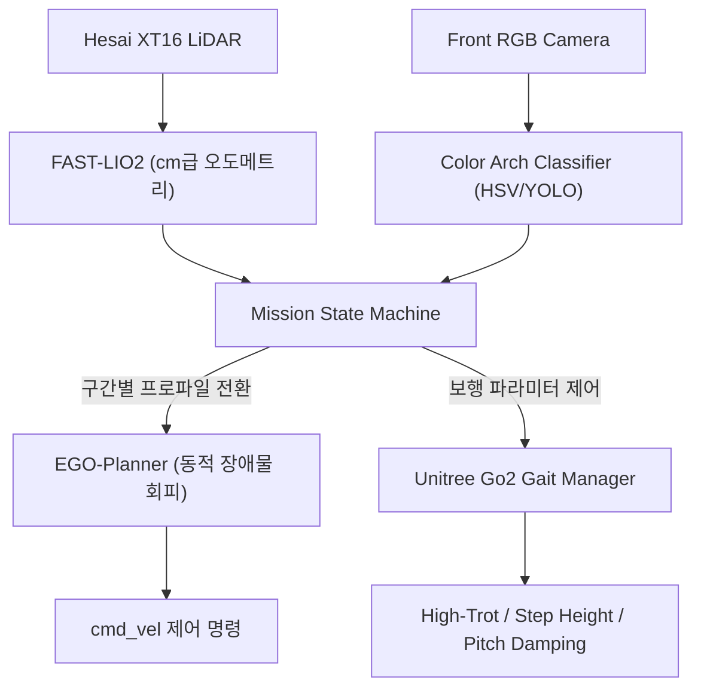

# 02. 3일차 미션 수행 경기 설계

> 11-17 대회 전에 쓴 설계안이다. 실제 대회 주행은 기록한 경로를 Nav2 RPP로 따라가는 방식으로 바뀌었고, EGO-Planner는 쓰지 않았다. 지금 방식은 [STRUCTURE.md](STRUCTURE.md)와 [RUN.md](RUN.md)에 있다.

## 1. 경기 개요 및 미션 분석
* **배점**: 150점 만점 (최종 점수 반영 비율 **70%**)
* **경기 시간**: 5분 이내 코스 완주
* **경기 방식**: 단독 주행, 장애물 코스 완주 시간 및 미션별 배점 합산 (3회 주행 중 최고 점수 회차 반영)
* **미션 구성 및 배점**:
  1. **콘 슬라롬 (20점)**: 콘(밑면 300×300 mm, 높이 615 mm) 지그재그 회피 주행
  2. **색상 아치 통과 (20점)**: 높이 800 mm 아치. 출발 전 추첨된 지정 색상(Red/Green/Blue 등)을 비전으로 식별 후 해당 아치로 진입 통과
  3. **경사로(Ramp) 통과 (20점)**: 오르막, 평지, 내리막 모듈형 램프 주행
  4. **타이어 구간 (20점)**: CST 16×3.0 타이어(외경 450 mm, 폭 76 mm) 구간 통과
  5. **협소 통로 (20점)**: 폭 700 mm, 벽 높이 600 mm 구간 통과
  6. **코스 완주 (50점)**: 전체 미션 완주 후 4족 모두 결승선 통과
* **감점 규정**:
  - 장애물 접촉 및 전도: 1회당 **-5점**
  - 로봇 전도(낙상): 1회당 **-5점**
  - 트랙 라인 침범: 1회당 **-10점**
  - 미션 미수행(스킵): 해당 미션 점수 미부여 (0점)

---

## 2. 모듈별 기술 아키텍처 및 구현 전략

### 2.1 콘 슬라롬 (Cone Slalom)
* **특성**: 높이 615 mm의 콘은 Hesai XT16의 16채널 빔에 명확히 검출됨.
* **센서 필터링**: 링별 포인트클라우드 지면 분리(Ground Segmentation) 후 높이 0.1 m ~ 0.7 m 사이의 클러스터를 장애물 그리드에 등록.
* **경로 계획**: EGO-Planner의 inflation radius를 0.20 m로 설정하여 콘 반경 150 mm + 안전 마진 200 mm = 최소 350 mm 이격 주행 보장 (접촉 감점 방지).

### 2.2 색상 아치 인식 및 선택 통과 (Color Arch)
* **하드웨어 제약**: 로봇 및 상단 라이다 마운트의 전체 지상고는 **800 mm 미만**이어야 아치 프레임 간섭 없음 (현재 마운트 설계 기준 지상고 약 600 mm로 규격 충족).
* **비전 알고리즘**:
  1. 전방 카메라 영상을 실시간 취득하여 아치 상단 색상 패치 영역 ROI 검출.
  2. HSV 색공간 임계값 필터링 및 컨투어 면적 판별(또는 경량 YOLOv8 분류기 적용).
  3. 지정 색상과 일치하는 아치의 중심 좌표를 카메라-로봇 캘리브레이션 매트릭스를 통해 3D Waypoint로 투영.
* **주행 분기**:
  - 인식 완료 전: 아치 전방 1.5 m 대기/저속 접근.
  - 인식 완료 후: EGO-Planner 목표점(`goal_pose`)을 해당 색상 아치 통과 경로로 전환.

### 2.3 경사로(Ramp) 주행
* **문제점**: 경사면 진입 시 라이다 포인트클라우드가 전방 벽체로 오인식되어 비정상 정지 발생 가능.
* **해결책**:
  1. FAST-LIO 기반 IMU 피치각 실시간 모니터링 ($|\theta_{pitch}| > 10^\circ$).
  2. 램프 구간 통과 시 장애물 필터링 높이 임계값을 지면 법선 벡터 기준으로 동적 보정.
  3. Go2 자체 밸런싱 모드(Terrain Adaptation) 활성화 및 전방 추진력 보강을 위한 속도 게인 조정.

### 2.4 타이어 구간 (Tire Section)
* **특성**: 타이어 내부 빈 공간 및 불규칙 높이로 인해 발 빠짐 및 다리 걸림 위험 존재.
* **보행 제어 전략**:
  1. EGO-Planner는 타이어 외곽을 통과 가능한 지형으로 보되 최적 착지 라인을 추종.
  2. Go2 Sport Mode API를 통해 보행 높이(`step_height`)를 기본 6 cm에서 최대 12 cm로 상향.
  3. 보행 주파수를 낮추고 안정성이 높은 High-Step Trot 모드로 전환하여 다리 걸림 원천 차단.

### 2.5 협소 통로 (Narrow Corridor - 폭 700 mm)
* **특성**: 로봇 차폭 약 310 mm, 통로 폭 700 mm로 좌우 여유 간격이 각 195 mm에 불과함.
* **플래너 튜닝**:
  - 일반 주행 시 EGO-Planner의 `grid_map/inflation_radius`는 0.25~0.30 m로 설정되어 있어 협소 통로 진입 시 경로 생성이 불가능(Trapped)해짐.
  - 협소 통로 진입 전 State Machine이 `inflation_radius`를 **0.12 m**로 동적 축소.
  - 벽면 포인트클라우드의 좌우 대칭 오차를 최소화하는 Center-Line Aligner 보조 제어기 가동.

---

## 3. 종합 상태 제어 머신 (Mission State Machine)

| 상태 (State) | 진입 조건 | 플래너 설정 | 보행 모드 | 목표 행동 |
| :--- | :--- | :--- | :--- | :--- |
| `IDLE_START` | 출발 대기 | 비활성화 | Stand | 녹색 신호등 대기 |
| `SLALOM` | 출발 신호 감지 | Inflation: 0.20 m, $v_{max}=0.5\text{ m/s}$ | Normal Trot | 콘 지그재그 회피 |
| `ARCH_DETECT` | 아치 전방 1.5 m 도달 | $v_{max}=0.2\text{ m/s}$ 저속 유지 | Normal Trot | 색상 인식 및 목표 분기점 산출 |
| `ARCH_PASS` | 색상 타겟 확정 | 아치 중심 Waypoint 추종 | Low-Height Trot | 해당 아치 중심 통과 |
| `RAMP` | 램프 진입점 도달 | 지면 필터링 보정 | Terrain Adapt Trot | 경사로 안정 등판 및 하강 |
| `TIRE` | 타이어 구간 진입 | Inflation: 0.15 m | High-Step Trot (12 cm) | 발 걸림 방지 구간 돌파 |
| `NARROW_PASS` | 통로 입구 진입 | Inflation: **0.12 m**, Center-Lock | Stable Slow Trot ($0.3\text{ m/s}$) | 벽 접촉 방지 통과 |
| `FINISH` | 최종 직선 구간 | Inflation: 0.20 m, $v_{max}=0.8\text{ m/s}$ | Fast Trot | 결승선 4족 완전 통과 |
